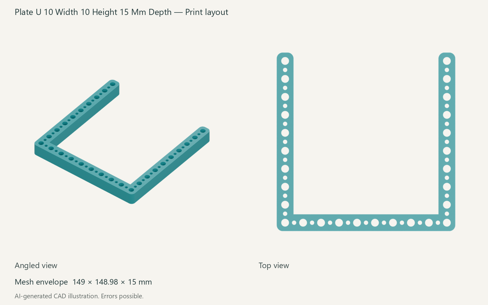

<!-- oobb-presentation:start -->
# OOBB U plates

AI-generated images and instructions. Errors possible.

## Summary

Parametric OOBB U-shaped mounting plates in the available width, height and depth combinations.

This is an entirely AI-generated coding project. The generated outputs are included and usually work, but the main purpose of publishing it is to give others a starting point for modifying the project with their own AI tools.

[Example part](parts/oobb_part_plate_u_10_width_10_height_15_mm_depth/)

## Details

This catalogue contains **136 records**. [Browse OOBB navigation](navigation_oobb/oobb/part/plate_u/).

Each part has one canonical folder, its full OOMP ID and complete metadata. Navigation links open folders; use GitHub’s file pane to browse the available files.

[Build and maintenance guide](CATALOGUE_BUILD.md)

## Parts

Choose a U plate for the required opening and mounting arrangement. Mounting hardware is not specified by this catalogue.

## Assembly

Prepare the selected print-adjusted mesh in your slicer. Check the opening, hole layout and orientation against the mating components.
<!-- oobb-presentation:end -->
