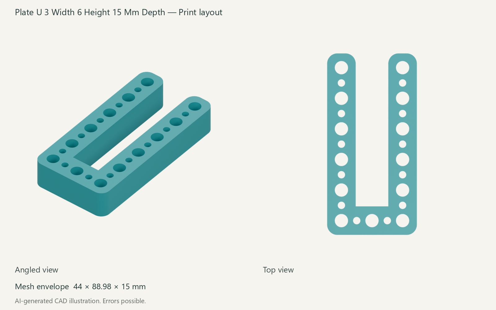

<!-- oobb-presentation:start -->
# Oobb Part Plate U 3 Width 6 Height 15 Mm Depth

AI-generated images and instructions. Errors possible.

## Summary

Parametric OOBB U-shaped mounting plates in the available width, height and depth combinations.

This is an entirely AI-generated coding project. The generated outputs are included and usually work, but the main purpose of publishing it is to give others a starting point for modifying the project with their own AI tools.



## Details

**Full OOMP ID:** `oobb_part_plate_u_3_width_6_height_15_mm_depth`

[Part folder](./) · [OOBB navigation](../../navigation_oobb/)

| Field | Value |
| --- | --- |
| Depth | 15 |
| Height | 6 |
| Oobb Name | plate_u |
| Thickness | 15 |
| Width | 3 |
| Taxonomy | oobb / part / plate_u / 3_width / 6_height / 15_mm_depth |

<details>
<summary>Full part details: all working.yaml fields</summary>

```yaml
bip_39_2_word_array:
- device
- exhaust
bip_39_2_word_no_space: deviceexhaust
bip_39_2_word_space: device exhaust
bip_39_2_word_underscore: device_exhaust
bip_39_3_word_array:
- device
- exhaust
- mirror
bip_39_3_word_no_space: deviceexhaustmirror
bip_39_3_word_space: device exhaust mirror
bip_39_3_word_underscore: device_exhaust_mirror
bip_39_full_array:
- device
- exhaust
- mirror
- diary
- lazy
- stamp
- muffin
- promote
- fossil
- denial
- income
- tiger
bip_39_full_no_space: deviceexhaustmirrordiarylazystampmuffinpromotefossildenialincometiger
bip_39_full_space: device exhaust mirror diary lazy stamp muffin promote fossil denial
  income tiger
bip_39_full_underscore: device_exhaust_mirror_diary_lazy_stamp_muffin_promote_fossil_denial_income_tiger
classification: oobb
color: ''
description_extra: ''
description_main: 3_width_6_height_15_mm_depth
directory: parts/oobb_part_plate_u_3_width_6_height_15_mm_depth
height: 6
id: oobb_part_plate_u_3_width_6_height_15_mm_depth
id_no_class: part_plate_u_3_width_6_height_15_mm_depth
id_no_size: 3_width_6_height_15_mm_depth
id_no_type: plate_u_3_width_6_height_15_mm_depth
id_oobb: oobb_part_plate_u_3_width_6_height_15_mm_depth
kwargs:
  depth: 15
  filter: ''
  generate_stl: false
  height: 6
  modes:
  - 3dpr
  navigation: false
  oobb_name: plate_u
  oomp_description_extra: ''
  oomp_description_main: plate_u_3_width_6_height_15_mm_depth
  oomp_mode: project
  oomp_run: false
  overwrite: true
  thickness: 15
  typ: fast
  type: default_plate_u
  width: 3
link_github: https://github.com/oomlout/oomlout_oomp_version_1_messy/tree/main/parts/oobb_part_plate_u_3_width_6_height_15_mm_depth
link_main: https://github.com/oomlout/oomlout_oomp_version_1_messy/tree/main/parts/oobb_part_plate_u_3_width_6_height_15_mm_depth
link_redirect: https://github.com/oomlout/oomlout_oomp_version_1_messy/tree/main/parts/oobb_part_plate_u_3_width_6_height_15_mm_depth
manufacturer: ''
md5: 3ca9ee361ea7e7a8e44d615be74dca70
md5_10: 3ca9ee361e
md5_10_upper: 3CA9EE361E
md5_5: 3ca9e
md5_5_upper: 3CA9E
md5_6: 3ca9ee
md5_6_alpha: 2d7n2
md5_6_alpha_upper: 2D7N2
md5_6_upper: 3CA9EE
name: plate_u
name_no_class: Part Plate U 3 Width 6 Height 15 Mm Depth
name_no_size: 3 Width 6 Height 15 Mm Depth
name_no_type: Plate U 3 Width 6 Height 15 Mm Depth
name_proper: Oobb Part Plate U 3 Width 6 Height 15 Mm Depth
name_space: oobb part plate u 3 width 6 height 15 mm depth
name_upper: OOBB PART PLATE U 3 WIDTH 6 HEIGHT 15 MM DEPTH
oobb_details:
  depth: 15
  height: 6
  oobb_name: plate_u
  thickness: 15
  width: 3
oobb_name: plate_u
oomlout_ai_roboclick_1:
  actions:
  - command: text_jinja_template
    convert_to_pdf: false
    convert_to_png: false
    dict_data:
      classification: oobb
      color: ''
      description_extra: ''
      description_main: 3_width_6_height_15_mm_depth
      directory: parts\oobb_part_plate_u_3_width_6_height_15_mm_depth
      height: 6
      manufacturer: ''
      name: oobb_part_plate_u_3_width_6_height_15_mm_depth
      name_proper: Oobb Part Plate U 3 Width 6 Height 15 Mm Depth
      name_space: oobb part plate u 3 width 6 height 15 mm depth
      name_upper: OOBB PART PLATE U 3 WIDTH 6 HEIGHT 15 MM DEPTH
      oobb_details:
        depth: 15
        height: 6
        oobb_name: plate_u
        thickness: 15
        width: 3
      part_number: ''
      size: plate_u
      taxonomy_1: oobb
      taxonomy_10: ''
      taxonomy_11: ''
      taxonomy_12: ''
      taxonomy_13: ''
      taxonomy_14: ''
      taxonomy_15: ''
      taxonomy_2: part
      taxonomy_3: plate_u
      taxonomy_4: 3_width
      taxonomy_5: 6_height
      taxonomy_6: 15_mm_depth
      taxonomy_7: ''
      taxonomy_8: ''
      taxonomy_9: ''
      thickness: 15
      type: part
      url_chat: ''
      width: 3
    dict_data_files: {}
    dict_data_files_exists: {}
    file_output: label_oomp.svg
    file_template: C:\gh\oomlout_oobb_part_plate_u_version_5\source_file\template_jinja\template_jinja_label_oomlout_76_2_mm_50_8_mm\working.svg.j2
    search_and_replace: []
  file_test: label_oomp.pdf
  retries_until_complete: 0
oomp_key: oomp_oobb_part_plate_u_3_width_6_height_15_mm_depth
part_number: ''
project_name: C:\gh\oomlout_oobb_part_plate_u_version_5
size: plate_u
taxonomy_1: oobb
taxonomy_10: ''
taxonomy_11: ''
taxonomy_12: ''
taxonomy_13: ''
taxonomy_14: ''
taxonomy_15: ''
taxonomy_1_capital: Oobb
taxonomy_1_first_letter: o
taxonomy_1_first_letter_upper: O
taxonomy_1_length_1: o
taxonomy_1_length_2: oo
taxonomy_1_length_3: oob
taxonomy_1_length_4: oobb
taxonomy_1_length_5: oobb
taxonomy_1_upper: OOBB
taxonomy_1_upper_length_1: O
taxonomy_1_upper_length_2: OO
taxonomy_1_upper_length_3: OOB
taxonomy_1_upper_length_4: OOBB
taxonomy_1_upper_length_5: OOBB
taxonomy_2: part
taxonomy_2_capital: Part
taxonomy_2_first_letter: p
taxonomy_2_first_letter_upper: P
taxonomy_2_length_1: p
taxonomy_2_length_2: pa
taxonomy_2_length_3: par
taxonomy_2_length_4: part
taxonomy_2_length_5: part
taxonomy_2_upper: PART
taxonomy_2_upper_length_1: P
taxonomy_2_upper_length_2: PA
taxonomy_2_upper_length_3: PAR
taxonomy_2_upper_length_4: PART
taxonomy_2_upper_length_5: PART
taxonomy_3: plate_u
taxonomy_3_capital: Plate U
taxonomy_3_first_letter: p
taxonomy_3_first_letter_upper: P
taxonomy_3_length_1: p
taxonomy_3_length_2: pl
taxonomy_3_length_3: pla
taxonomy_3_length_4: plat
taxonomy_3_length_5: plate
taxonomy_3_upper: PLATE_U
taxonomy_3_upper_length_1: P
taxonomy_3_upper_length_2: PL
taxonomy_3_upper_length_3: PLA
taxonomy_3_upper_length_4: PLAT
taxonomy_3_upper_length_5: PLATE
taxonomy_4: 3_width
taxonomy_4_capital: 3 Width
taxonomy_4_first_letter: '3'
taxonomy_4_first_letter_upper: '3'
taxonomy_4_length_1: '3'
taxonomy_4_length_2: '3_'
taxonomy_4_length_3: 3_w
taxonomy_4_length_4: 3_wi
taxonomy_4_length_5: 3_wid
taxonomy_4_upper: 3_WIDTH
taxonomy_4_upper_length_1: '3'
taxonomy_4_upper_length_2: '3_'
taxonomy_4_upper_length_3: 3_W
taxonomy_4_upper_length_4: 3_WI
taxonomy_4_upper_length_5: 3_WID
taxonomy_5: 6_height
taxonomy_5_capital: 6 Height
taxonomy_5_first_letter: '6'
taxonomy_5_first_letter_upper: '6'
taxonomy_5_length_1: '6'
taxonomy_5_length_2: '6_'
taxonomy_5_length_3: 6_h
taxonomy_5_length_4: 6_he
taxonomy_5_length_5: 6_hei
taxonomy_5_upper: 6_HEIGHT
taxonomy_5_upper_length_1: '6'
taxonomy_5_upper_length_2: '6_'
taxonomy_5_upper_length_3: 6_H
taxonomy_5_upper_length_4: 6_HE
taxonomy_5_upper_length_5: 6_HEI
taxonomy_6: 15_mm_depth
taxonomy_6_capital: 15 mm Depth
taxonomy_6_first_letter: '1'
taxonomy_6_first_letter_upper: '1'
taxonomy_6_length_1: '1'
taxonomy_6_length_2: '15'
taxonomy_6_length_3: '15_'
taxonomy_6_length_4: 15_m
taxonomy_6_length_5: 15_mm
taxonomy_6_upper: 15_MM_DEPTH
taxonomy_6_upper_length_1: '1'
taxonomy_6_upper_length_2: '15'
taxonomy_6_upper_length_3: '15_'
taxonomy_6_upper_length_4: 15_M
taxonomy_6_upper_length_5: 15_MM
taxonomy_7: ''
taxonomy_8: ''
taxonomy_9: ''
thickness: 15
type: part
url_chat: ''
width: 3
```

</details>

## Parts

Choose a U plate for the required opening and mounting arrangement. Mounting hardware is not specified by this catalogue.

## Assembly

Prepare the selected print-adjusted mesh in your slicer. Check the opening, hole layout and orientation against the mating components.
<!-- oobb-presentation:end -->
