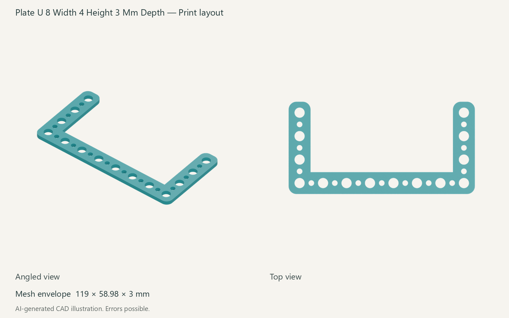

<!-- oobb-presentation:start -->
# Oobb Part Plate U 8 Width 4 Height 3 Mm Depth

AI-generated images and instructions. Errors possible.

## Summary

Parametric OOBB U-shaped mounting plates in the available width, height and depth combinations.

This is an entirely AI-generated coding project. The generated outputs are included and usually work, but the main purpose of publishing it is to give others a starting point for modifying the project with their own AI tools.



## Details

**Full OOMP ID:** `oobb_part_plate_u_8_width_4_height_3_mm_depth`

[Part folder](./) · [OOBB navigation](../../navigation_oobb/)

| Field | Value |
| --- | --- |
| Depth | 3 |
| Height | 4 |
| Oobb Name | plate_u |
| Thickness | 3 |
| Width | 8 |
| Taxonomy | oobb / part / plate_u / 8_width / 4_height / 3_mm_depth |

<details>
<summary>Full part details: all working.yaml fields</summary>

```yaml
bip_39_2_word_array:
- paddle
- bridge
bip_39_2_word_no_space: paddlebridge
bip_39_2_word_space: paddle bridge
bip_39_2_word_underscore: paddle_bridge
bip_39_3_word_array:
- paddle
- bridge
- liberty
bip_39_3_word_no_space: paddlebridgeliberty
bip_39_3_word_space: paddle bridge liberty
bip_39_3_word_underscore: paddle_bridge_liberty
bip_39_full_array:
- paddle
- bridge
- liberty
- cost
- reveal
- warm
- vault
- nest
- drive
- dinner
- diesel
- slab
bip_39_full_no_space: paddlebridgelibertycostrevealwarmvaultnestdrivedinnerdieselslab
bip_39_full_space: paddle bridge liberty cost reveal warm vault nest drive dinner
  diesel slab
bip_39_full_underscore: paddle_bridge_liberty_cost_reveal_warm_vault_nest_drive_dinner_diesel_slab
classification: oobb
color: ''
description_extra: ''
description_main: 8_width_4_height_3_mm_depth
directory: parts/oobb_part_plate_u_8_width_4_height_3_mm_depth
height: 4
id: oobb_part_plate_u_8_width_4_height_3_mm_depth
id_no_class: part_plate_u_8_width_4_height_3_mm_depth
id_no_size: 8_width_4_height_3_mm_depth
id_no_type: plate_u_8_width_4_height_3_mm_depth
id_oobb: oobb_part_plate_u_8_width_4_height_3_mm_depth
kwargs:
  depth: 3
  filter: ''
  generate_stl: false
  height: 4
  modes:
  - 3dpr
  navigation: false
  oobb_name: plate_u
  oomp_description_extra: ''
  oomp_description_main: plate_u_8_width_4_height_3_mm_depth
  oomp_mode: project
  oomp_run: false
  overwrite: true
  thickness: 3
  typ: fast
  type: default_plate_u
  width: 8
link_github: https://github.com/oomlout/oomlout_oomp_version_1_messy/tree/main/parts/oobb_part_plate_u_8_width_4_height_3_mm_depth
link_main: https://github.com/oomlout/oomlout_oomp_version_1_messy/tree/main/parts/oobb_part_plate_u_8_width_4_height_3_mm_depth
link_redirect: https://github.com/oomlout/oomlout_oomp_version_1_messy/tree/main/parts/oobb_part_plate_u_8_width_4_height_3_mm_depth
manufacturer: ''
md5: 9ec37a03985b87ee7c74a44347c8f665
md5_10: 9ec37a0398
md5_10_upper: 9EC37A0398
md5_5: 9ec37
md5_5_upper: 9EC37
md5_6: 9ec37a
md5_6_alpha: 670ca
md5_6_alpha_upper: 670CA
md5_6_upper: 9EC37A
name: plate_u
name_no_class: Part Plate U 8 Width 4 Height 3 Mm Depth
name_no_size: 8 Width 4 Height 3 Mm Depth
name_no_type: Plate U 8 Width 4 Height 3 Mm Depth
name_proper: Oobb Part Plate U 8 Width 4 Height 3 Mm Depth
name_space: oobb part plate u 8 width 4 height 3 mm depth
name_upper: OOBB PART PLATE U 8 WIDTH 4 HEIGHT 3 MM DEPTH
oobb_details:
  depth: 3
  height: 4
  oobb_name: plate_u
  thickness: 3
  width: 8
oobb_name: plate_u
oomlout_ai_roboclick_1:
  actions:
  - command: text_jinja_template
    convert_to_pdf: false
    convert_to_png: false
    dict_data:
      classification: oobb
      color: ''
      description_extra: ''
      description_main: 8_width_4_height_3_mm_depth
      directory: parts\oobb_part_plate_u_8_width_4_height_3_mm_depth
      height: 4
      manufacturer: ''
      name: oobb_part_plate_u_8_width_4_height_3_mm_depth
      name_proper: Oobb Part Plate U 8 Width 4 Height 3 Mm Depth
      name_space: oobb part plate u 8 width 4 height 3 mm depth
      name_upper: OOBB PART PLATE U 8 WIDTH 4 HEIGHT 3 MM DEPTH
      oobb_details:
        depth: 3
        height: 4
        oobb_name: plate_u
        thickness: 3
        width: 8
      part_number: ''
      size: plate_u
      taxonomy_1: oobb
      taxonomy_10: ''
      taxonomy_11: ''
      taxonomy_12: ''
      taxonomy_13: ''
      taxonomy_14: ''
      taxonomy_15: ''
      taxonomy_2: part
      taxonomy_3: plate_u
      taxonomy_4: 8_width
      taxonomy_5: 4_height
      taxonomy_6: 3_mm_depth
      taxonomy_7: ''
      taxonomy_8: ''
      taxonomy_9: ''
      thickness: 3
      type: part
      url_chat: ''
      width: 8
    dict_data_files: {}
    dict_data_files_exists: {}
    file_output: label_oomp.svg
    file_template: C:\gh\oomlout_oobb_part_plate_u_version_5\source_file\template_jinja\template_jinja_label_oomlout_76_2_mm_50_8_mm\working.svg.j2
    search_and_replace: []
  file_test: label_oomp.pdf
  retries_until_complete: 0
oomp_key: oomp_oobb_part_plate_u_8_width_4_height_3_mm_depth
part_number: ''
project_name: C:\gh\oomlout_oobb_part_plate_u_version_5
size: plate_u
taxonomy_1: oobb
taxonomy_10: ''
taxonomy_11: ''
taxonomy_12: ''
taxonomy_13: ''
taxonomy_14: ''
taxonomy_15: ''
taxonomy_1_capital: Oobb
taxonomy_1_first_letter: o
taxonomy_1_first_letter_upper: O
taxonomy_1_length_1: o
taxonomy_1_length_2: oo
taxonomy_1_length_3: oob
taxonomy_1_length_4: oobb
taxonomy_1_length_5: oobb
taxonomy_1_upper: OOBB
taxonomy_1_upper_length_1: O
taxonomy_1_upper_length_2: OO
taxonomy_1_upper_length_3: OOB
taxonomy_1_upper_length_4: OOBB
taxonomy_1_upper_length_5: OOBB
taxonomy_2: part
taxonomy_2_capital: Part
taxonomy_2_first_letter: p
taxonomy_2_first_letter_upper: P
taxonomy_2_length_1: p
taxonomy_2_length_2: pa
taxonomy_2_length_3: par
taxonomy_2_length_4: part
taxonomy_2_length_5: part
taxonomy_2_upper: PART
taxonomy_2_upper_length_1: P
taxonomy_2_upper_length_2: PA
taxonomy_2_upper_length_3: PAR
taxonomy_2_upper_length_4: PART
taxonomy_2_upper_length_5: PART
taxonomy_3: plate_u
taxonomy_3_capital: Plate U
taxonomy_3_first_letter: p
taxonomy_3_first_letter_upper: P
taxonomy_3_length_1: p
taxonomy_3_length_2: pl
taxonomy_3_length_3: pla
taxonomy_3_length_4: plat
taxonomy_3_length_5: plate
taxonomy_3_upper: PLATE_U
taxonomy_3_upper_length_1: P
taxonomy_3_upper_length_2: PL
taxonomy_3_upper_length_3: PLA
taxonomy_3_upper_length_4: PLAT
taxonomy_3_upper_length_5: PLATE
taxonomy_4: 8_width
taxonomy_4_capital: 8 Width
taxonomy_4_first_letter: '8'
taxonomy_4_first_letter_upper: '8'
taxonomy_4_length_1: '8'
taxonomy_4_length_2: '8_'
taxonomy_4_length_3: 8_w
taxonomy_4_length_4: 8_wi
taxonomy_4_length_5: 8_wid
taxonomy_4_upper: 8_WIDTH
taxonomy_4_upper_length_1: '8'
taxonomy_4_upper_length_2: '8_'
taxonomy_4_upper_length_3: 8_W
taxonomy_4_upper_length_4: 8_WI
taxonomy_4_upper_length_5: 8_WID
taxonomy_5: 4_height
taxonomy_5_capital: 4 Height
taxonomy_5_first_letter: '4'
taxonomy_5_first_letter_upper: '4'
taxonomy_5_length_1: '4'
taxonomy_5_length_2: '4_'
taxonomy_5_length_3: 4_h
taxonomy_5_length_4: 4_he
taxonomy_5_length_5: 4_hei
taxonomy_5_upper: 4_HEIGHT
taxonomy_5_upper_length_1: '4'
taxonomy_5_upper_length_2: '4_'
taxonomy_5_upper_length_3: 4_H
taxonomy_5_upper_length_4: 4_HE
taxonomy_5_upper_length_5: 4_HEI
taxonomy_6: 3_mm_depth
taxonomy_6_capital: 3 mm Depth
taxonomy_6_first_letter: '3'
taxonomy_6_first_letter_upper: '3'
taxonomy_6_length_1: '3'
taxonomy_6_length_2: '3_'
taxonomy_6_length_3: 3_m
taxonomy_6_length_4: 3_mm
taxonomy_6_length_5: 3_mm_
taxonomy_6_upper: 3_MM_DEPTH
taxonomy_6_upper_length_1: '3'
taxonomy_6_upper_length_2: '3_'
taxonomy_6_upper_length_3: 3_M
taxonomy_6_upper_length_4: 3_MM
taxonomy_6_upper_length_5: 3_MM_
taxonomy_7: ''
taxonomy_8: ''
taxonomy_9: ''
thickness: 3
type: part
url_chat: ''
width: 8
```

</details>

## Parts

Choose a U plate for the required opening and mounting arrangement. Mounting hardware is not specified by this catalogue.

## Assembly

Prepare the selected print-adjusted mesh in your slicer. Check the opening, hole layout and orientation against the mating components.
<!-- oobb-presentation:end -->
